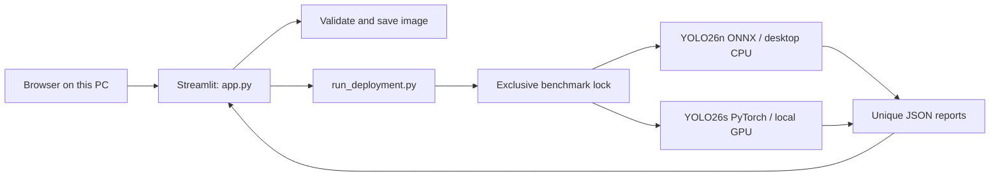

# Driving assistant architecture

## Implemented system

The current application is a local model-research interface. It wraps the existing offline profiling pipeline. It does not implement mobile camera capture, remote transport, labeled-data evaluation, tracking, depth fusion or collision alerts.

The graph shows responsibilities; the runner executes the chosen profiles sequentially, not concurrently. Browser communication remains on loopback (`127.0.0.1`). Streamlit handles form submissions and session state; no public API or remote user authentication is provided. Do not expose this development service to the internet.

## Components

| File | Responsibility |
| --- | --- |
| `app.py` | Declarative Streamlit page: instructions, form, progress, errors, results and explanations |
| `app_support.py` | Validate/decode images, create unique input files, invoke runner, locate and read reports |
| `scripts/start_app.ps1` | Start the local browser service with the project's interpreter |
| `configs/deployment.json` | Resolve phone/backend profile to model and device |
| `scripts/run_deployment.py` | Validate local artifacts, reserve output directory, serialize execution using FileLock |
| `scripts/profile_models.py` | Warmup, prediction timing, CUDA synchronization, memory and artifact metadata |
| `scripts/train.py` | Separate fine-tuning entry point; not triggered by the UI |
| `.streamlit/config.toml` | Loopback binding, upload limit, theme and disabled usage-stat collection |

`app.py` uses the framework's top-to-bottom rerun model; it is not a persistent worker loop. The existing CLI runner retains its `main` orchestration and shared logging API. UI functions are in a small support module. The UI calls its subprocess synchronously, so one submission remains busy until completion/failure. Browser reload or connection loss does not provide a reliable cancellation mechanism.

## Input and execution contract

The user submits a selected mode, a sample/upload choice and 20/100/200 measured predictions. A JPEG/PNG must be nonempty, at most 10 MiB and at most 12 million decoded pixels. Pillow decodes it and converts it to RGB; an extension alone is insufficient. A unique PNG is stored under `data/local-inputs`. This prevents collisions and avoids carrying uploaded filenames into subprocess arguments.

The app invokes the runner as a list of arguments, without a shell. The runner rechecks positive frame count, input existence and required local models. Model acquisition/export happens separately. Each run reserves a UUID directory under `reports/deployment`. The lock spans the selected profiles; another runner fails immediately instead of contending for the GPU. This lock covers runners using this command, not unrelated applications or direct profiler invocations.

Each profile uses square 640-pixel, batch-one input, ten warmups and the requested timed predictions. Phone mode uses the prepared FP32 ONNX model's NMS-free head; backend mode uses FP32 PyTorch and the library's default head. Export parity was checked on one bundled image, not a labeled validation set. The runner's per-profile timeout is 600 seconds; the UI parent timeout is 1,250 seconds. If the parent times out or disconnects, a child may continue until its own timeout; the UI instructs users to wait before retrying.

## Reports and UI state

Reports include model/hash, runtime versions, source path, device, image size, warmup/count, mean/p50/p95 prediction latency, serial prediction rate, stage timings and process memory. CUDA allocation counters exclude driver memory; CPU-mode PyTorch GPU counters are null and do not describe ONNX allocation. The UI surfaces only the most useful timing fields and offers the complete JSON for download.

The UI extracts the run ID from the runner's bounded structured log line, accepting only a 32-character lowercase hexadecimal ID. This is a deliberate adapter to the existing CLI, not a general log parser. Future refactoring should replace it with an explicit versioned result manifest. Both-mode success requires both report files and nonempty result arrays. A nonzero exit is failure even if a partial report exists.

The current profiler writes JSON directly; a crash can leave partial files. The UI reads only after successful subprocess completion and rejects incomplete results. Unique directories prevent prior results being overwritten. This is not transactional artifact publication, and crashed/empty run directories require manual cleanup. There is no database, index, migration or historical-results browser.

Completed results live in Streamlit session state and are labeled as the last completed test. Control changes take effect only on submission; a new submission clears old results before running. Inputs are persisted separately from browser state. The app displays the tested input image and timings; it does not yet render new detection boxes.

## Privacy and failure boundaries

No remote image service is called by the application. Files remain in this project, subject to the machine's own backup/sync configuration, including OneDrive. Persisted images and JSON paths may be sensitive. No automatic deletion policy is implemented. The app is bound to loopback and relies on local machine access, not an application login.

Invalid/corrupt/oversized images, missing uploads, incomplete outputs, subprocess failures and timeouts produce user-facing guidance. Developer stack traces are not shown for these expected failures. Raw subprocess logs stay out of the result table. Model/GPU/lock failures currently share a concise recovery message; the CLI can be run directly for detailed diagnosis.

## Planned dual-deployment app

Both options remain part of the product. A mode selector appears before camera capture; switching stops the current session and discards stale results. Phone mode must never silently upload frames.

| Layer | Phone mode | Backend mode |
| --- | --- | --- |
| Capture | Native camera with frame IDs/timestamps | Same |
| Inference | On-device runtime and compact detector | Authenticated service and larger detector |
| Transport | No frame upload | Encrypted video/frame channel, explicit consent |
| Display | Local boxes and freshness state | Returned boxes associated with matching frame IDs |
| Failure | Model/camera unavailable | Degraded/disconnected/stale state, no old result reuse |

Exact mobile framework, hardware execution provider and transport await the phone/OS decision. ONNX is a starting artifact, not proof of handset compatibility or acceleration. Benchmark sustained thermals, memory, battery and export accuracy on the target phone. Backend work needs authentication, bounded payloads/rates, clock-offset handling, reconnection and one-frame queueing to avoid stale backlogs. Measure capture-to-display latency rather than adding isolated model speed to an assumed network budget.

Detection evaluation will use frozen scene-disjoint datasets and explicit class mapping; fine-tuning will compare recall at a matched false-positive rate. Distance requires a separate metric-depth model and calibration. TTC additionally requires temporal tracking and closing-speed estimates with uncertainty. None of these can be inferred from a fast detector or a confidence score.

## Validation approach

Tests cover image decoding/limits, incomplete results, safe run-ID resolution, unique input paths, the runner's process failure/lock behavior, and Streamlit welcome/error flows. A real UI submission verifies the complete sample-to-report path. Lint, formatting and new-function size checks supplement the tests. Synthetic/unit checks do not replace device, network, adverse-weather or labeled accuracy evaluation.
